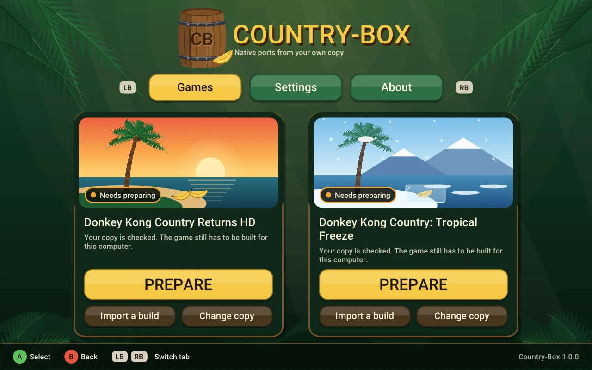

# Country-Box

**Native Linux and Steam Deck ports of *Donkey Kong Country Returns HD* and *Donkey Kong Country: Tropical Freeze*,
built on your machine from your own copy.**

[Español](docs/README.es.md) · [About](ABOUT.md) · [Requirements](#requirements) · [Install](docs/INSTALL.md) · [Install with an AI agent](AGENT-INSTALL.md) ·
[How it was tested](docs/TESTING.md) · [Known issues](docs/KNOWN-ISSUES.md) · [Changelog](CHANGELOG.md)

*The launcher — its art is our own, drawn in code. Out of respect for the games' owners, this repository shows no
screenshots or video of the games themselves.*

I wanted to play these two games natively on my Steam Deck — simple to set up, and smooth once running — and I
couldn't find a recompilation of either. So I made one. Country-Box is a **static recompilation**: the Switch game's
ARM64 code is turned into C, compiled for x86-64 and linked with a runtime that replaces the console's OS and draws
its graphics through Vulkan. The result is a native Linux executable.

> **Country-Box ships none of the game.** You bring your own copy (the Nintendo Switch version 1.0.0 of each game, without updates applied, extracted into
> `exefs/` + `romfs/` folders). The
> launcher checks it file by file, builds the game for your computer and runs it. Nothing here extracts or decrypts
> anything, and this project never says where to obtain a game.

## Status — version 1.0.1

| | Donkey Kong Country Returns HD | Donkey Kong Country: Tropical Freeze |
|---|---|---|
| Playable | ✅ whole game, PC and Steam Deck (Super Guide sweep) | ✅ played on PC and Steam Deck (no whole-game sweep) |
| Frame rate | 60 fps average in all **81 levels**, PC and Steam Deck; 99.97 % (PC) and 99.92 % (Deck) of frames without a hitch | 60 fps average on the three measured levels |
| Shaders prepared before you play | ✅ 0 compiled during play (5 levels, empty cache) | ⚠️ ~30 still translated at each level load ([known issue](docs/KNOWN-ISSUES.md)) |
| Native 16:10 (Steam Deck panel) | — (16:9) | ✅ (video cinematics stretched) |
| Steam Deck (OLED) | all 81 levels at 60 fps with the APU at **8–9 W** | played on the Deck |

All figures are measured (2026-11-11/12) and listed with their source in [docs/TESTING.md](docs/TESTING.md); a
"hitch" is a frame that stays on screen longer than two refreshes. Returns HD
was walked end to end by the game's own **Super Guide**, level by level, not by hand.

## Requirements

**Your own copy of the game** — the Nintendo Switch release, **version 1.0.0, with no update applied**, extracted
into a folder that holds `exefs/` and `romfs/`:

| Game | Title ID | Version | Files checked |
|---|---|---|---|
| Donkey Kong Country Returns HD | `01009D901BC56000` | 1.0.0 | 368 |
| Donkey Kong Country: Tropical Freeze | `0100C1F0051B6000` | 1.0.0 | 88 |

The launcher checks every file by size and SHA-256 and tells you plainly if a file is missing, damaged, or from
another version (usually an update applied on top).

**A computer to build on** — Linux on x86-64:

- **CPU** with AVX2 (Intel Haswell / AMD Zen or newer). The Steam Deck qualifies to *run* the game, but it has no
  compiler: build on a PC and import the build.
- **GPU** with Vulkan.
- **Disk**: about 4.2 GB for Returns HD and 1.6 GB for Tropical Freeze, plus your copy.
- **Build tools**: `clang`, `lld`, `ninja`, `pkg-config`, `python3` (with `venv`), and the development packages of
  SDL3, Vulkan, Opus, libvpx and zlib. If something is missing, the launcher shows the exact install command for your
  distribution.
- **Internet**, once, on the first Prepare (it sets up its Python modules, about 40 MB).

## Install

1. Download the AppImage from [Releases](https://github.com/zWalt01/Country-Box/releases) and make it
   executable.
2. Open it, choose **Add your copy**, and point it at your extracted game folder.
3. Press **PREPARE**. The launcher sets up what it needs, converts and compiles the game for your computer, and
   prepares the shaders. If a system tool is missing it tells you the exact command for your distribution.
4. Press **PLAY**.

| First build (Ryzen 7 5700X3D, 16 threads) | Returns HD | Tropical Freeze |
|---|---|---|
| First time | **9 min 21 s** | **2 min 31 s** |
| After an update | seconds — only what changed is rebuilt | 10 s |

**Steam Deck:** SteamOS has no compiler. Build on a Linux PC and use **Import a build** on the Deck.
**With an AI agent:** give it [AGENT-INSTALL.md](AGENT-INSTALL.md) — it drives the launcher's command line, which
answers in JSON. Requirements, the manual build and the Deck steps: [docs/INSTALL.md](docs/INSTALL.md).

## About

I'm Walter, a data science student who wanted to find out how hard a project like this really is. I built it by
directing AI coding agents and checking every result against real runs — the whole story is in [ABOUT.md](ABOUT.md).
Questions and bugs: [Issues](https://github.com/zWalt01/Country-Box/issues).

## Credits

The recompilation core comes from **[Metroid Prime 4 Recomp](https://github.com/jaigner-hub/metroid-prime-4-recomp)**
by Jeff Aigner (MIT, commit `6c9c590`), which carries the lineage of fe3h-pc-recomp, totk-pc-recomp, LAS Recomp and
more — used with full credit as the base of a new project, not as a fork. Every component, with its commit and
license: [core/THIRD_PARTY_NOTICES.md](core/THIRD_PARTY_NOTICES.md); summary: [CREDITS.md](CREDITS.md). Fonts: BIZ
UDPGothic and Noto Sans (SIL OFL), fetched at build time.

## License

MIT — see [LICENSE](LICENSE). `core/` keeps its upstream MIT license and file headers.

## Legal

*Donkey Kong Country Returns HD* and *Donkey Kong Country: Tropical Freeze* are property of Nintendo / Retro Studios /
Forever Entertainment. Country-Box is an independent, non-commercial project, not affiliated with or endorsed by
them. It contains no game code, assets, keys or firmware, and you need your own legally obtained copy. Full
statement: [LEGAL.md](LEGAL.md).
