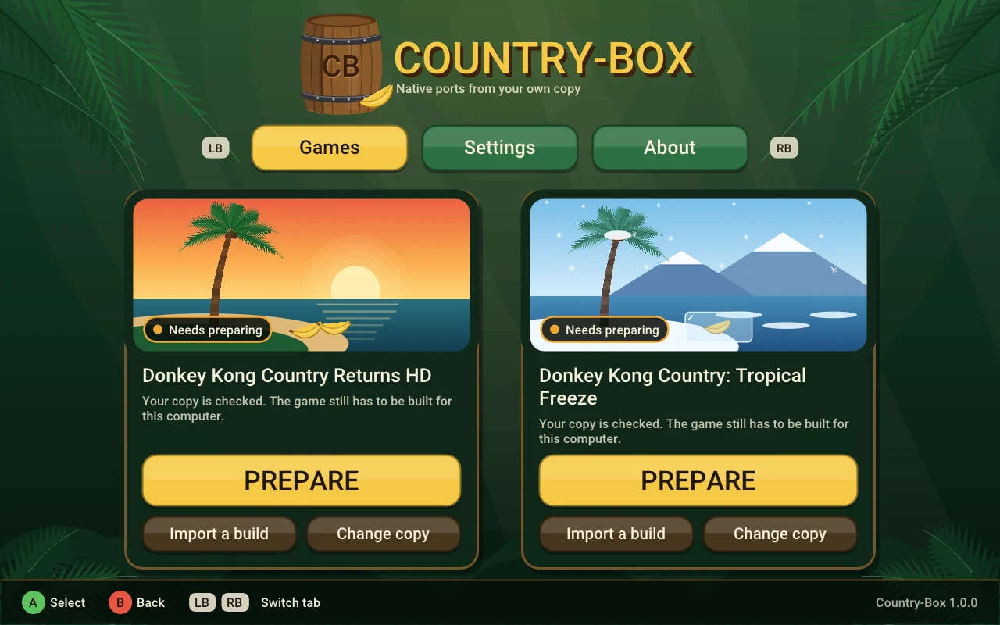

# Country-Box

**Ports nativos para Linux y Steam Deck de *Donkey Kong Country Returns HD* y *Donkey Kong Country: Tropical Freeze*,
compilados en tu computadora a partir de tu propia copia.**

[English](../README.md) · [Guía de instalación](INSTALL.md) · [Instalar con un agente de IA](../AGENT-INSTALL.md) ·
[Problemas conocidos](KNOWN-ISSUES.md) · [Sobre el proyecto](ABOUT.es.md) · [Cambios](../CHANGELOG.md)

<a href="https://recomplauncher.com"><picture><source media="(prefers-color-scheme: dark)" srcset="https://recomplauncher.com/assets/press/launcher/badge-light.svg"></picture></a>

*El launcher: su arte es propio, dibujado en código. Por respeto a los dueños de los juegos, este repositorio no
muestra capturas ni video de los juegos.*

Quería jugar estos dos juegos de forma nativa en mi Steam Deck, fáciles de instalar y fluidos al jugar, y no encontré
ninguna recompilación de ninguno. Así que hice una. El código del juego se convierte a C y se compila como un programa
nativo de Linux en tu propia computadora.

> **Country-Box no incluye nada de los juegos.** Tú pones tu propia copia; el launcher la verifica, compila el juego y
> lo ejecuta. Nada aquí extrae ni descifra nada, y este proyecto nunca dice dónde conseguir un juego.

## Requisitos

**Tu propia copia del juego**: Nintendo Switch, sin actualizaciones aplicadas, extraída en una carpeta con `exefs/` y
`romfs/`:

| Juego | Versión | Región probada | Title ID |
|---|---|---|---|
| Donkey Kong Country Returns HD | 1.0.0 | EE. UU. | `01009D901BC56000` |
| Donkey Kong Country: Tropical Freeze | 1.0.0 | EE. UU. | `0100C1F0051B6000` |

En Switch, las otras regiones suelen traer los mismos archivos; el launcher revisa tu copia y te dice si coincide.

**Una computadora para compilarlo:**

- **Linux en x86-64** con un CPU que tenga AVX2 (Intel Haswell / AMD Zen o más nuevo) y una GPU con Vulkan.
- **Herramientas de compilación** (`clang`, `lld`, `ninja` y algunas librerías): si falta alguna, el launcher te da el
  comando exacto para tu distribución.
- **Steam Deck:** ejecuta el juego, pero no lo puede compilar. Compílalo en una PC con Linux y usa **Import a build**
  en la Deck.

## Instalar

1. Baja el AppImage desde [Releases](https://github.com/zWalt01/Country-Box/releases) y dale permiso de ejecución.
2. Ábrelo, elige **Add your copy** y señala la carpeta de tu juego.
3. Pulsa **PREPARE**: unos 9 minutos para *Returns HD* y 2½ para *Tropical Freeze* en una PC de 8 núcleos, una sola vez.
4. Pulsa **PLAY**.

Las actualizaciones se instalan solas y sólo recompilan lo que cambió. ¿Usas un agente de IA? Dale
[AGENT-INSTALL.md](../AGENT-INSTALL.md). Todos los detalles: [INSTALL.md](INSTALL.md).

## Estado — versión 1.0.3

| | Returns HD | Tropical Freeze |
|---|---|---|
| Jugable | ✅ juego completo, PC y Steam Deck | ✅ PC y Steam Deck |
| Fluidez | 60 fps en los 81 niveles; 99.9 % de los frames sin tirones | 60 fps en los niveles medidos |
| Steam Deck | 60 fps con la APU a 8–9 W | se juega bien |
| Shaders | todos preparados antes de jugar | algunos se compilan al cargar un nivel: pausas cortas ([problema conocido](KNOWN-ISSUES.md)) |
| Pantalla 16:10 | 16:9 | ✅ 16:10 nativo |

Cómo se midió cada cifra: [TESTING.md](TESTING.md) (en inglés).

## Sobre el proyecto

Soy Walter, estudiante de ciencia de datos, y quería saber qué tan difícil es de verdad un proyecto así. Lo construí
dirigiendo agentes de IA y comprobando cada resultado con corridas reales; la historia está en
[ABOUT.es.md](ABOUT.es.md). Dudas y errores: [Issues](https://github.com/zWalt01/Country-Box/issues).

Basado en el núcleo de recompilación de [Metroid Prime 4 Recomp](https://github.com/jaigner-hub/metroid-prime-4-recomp)
de Jeff Aigner y los proyectos detrás de él; créditos completos en [CREDITS.md](CREDITS.md).

## Licencia y aviso legal

MIT — ver [LICENSE](../LICENSE). *Donkey Kong Country Returns HD* y *Tropical Freeze* pertenecen a Nintendo, Retro
Studios y Forever Entertainment; Country-Box es un proyecto independiente y sin fines de lucro, sin relación con ellos.
Necesitas tu propia copia obtenida legalmente. Declaración completa: [LEGAL.es.md](LEGAL.es.md).
